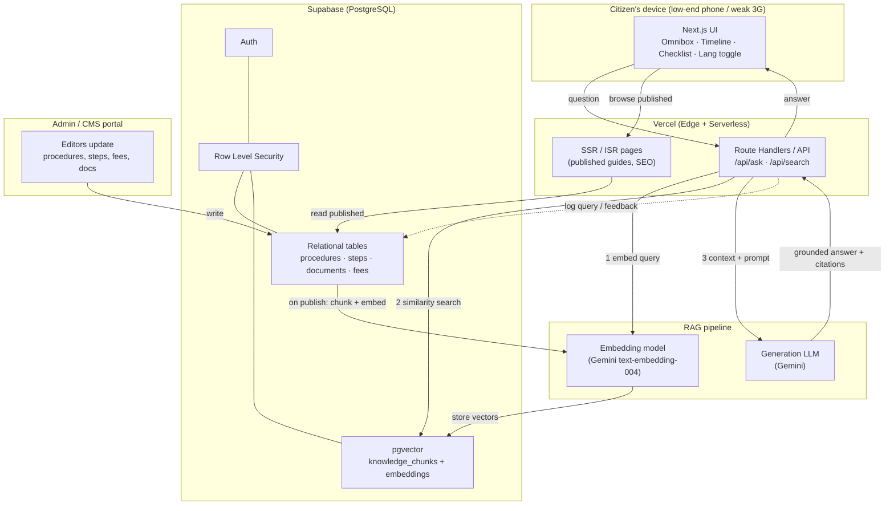
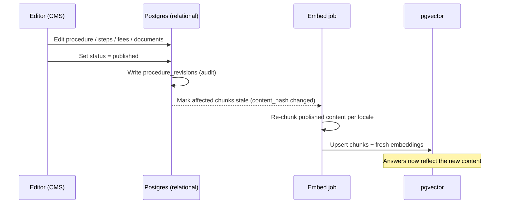

# Info-AI.LK — System Architecture

A centralized, AI-driven platform that answers Sri Lankan citizens' questions
about civic procedures (NIC, passports, vehicle revenue licenses, water/electricity
connections, Grama Niladhari forms, etc.) in **Sinhala, Tamil, and English** — and
renders the answer as a trackable, step-by-step procedure with a document checklist
rather than a wall of text.

The core engine is **Retrieval-Augmented Generation (RAG)**: authoritative
procedure content is curated by a data team, chunked and embedded into a vector
store, retrieved by semantic similarity at query time, and handed to an LLM to
compose a grounded, conversational answer. The LLM never invents fees or steps — it
re-states what the retrieved, human-authored content says, with citations back to
the source procedure.

---

## 1. Design goals

| Goal | Why it drives the architecture |
| --- | --- |
| **Trustworthy answers** | Civic info must be correct. Answers are grounded in curated content + citations; the LLM is a presenter, not a source of truth. |
| **Trilingual, Singlish-tolerant** | Citizens type in Sinhala, Tamil, English, romanized Sinhala, or a mix. Semantic (vector) retrieval + LLM interpretation handle this; keyword search alone cannot. |
| **Low-friction UI** | Users are often stressed, rushed, on low-end phones and weak 3G/4G. Search-first homepage, SSR for fast first paint, aggressive edge caching of published guides. |
| **Cheap to run, scales on spikes** | Traffic spikes when a mandate is announced. Serverless edge + managed Postgres scales without idle cost. |
| **Editable without deploys** | Fees and forms change often. A CMS lets data-entry operators update content; re-embedding happens automatically on publish. |

---

## 2. High-level architecture

---

## 3. Stack

| Layer | Choice | Notes |
| --- | --- | --- |
| **Frontend / hosting** | **Next.js on Vercel** | SSR + ISR for published guides (fast first paint, SEO). Edge caching. App Router. |
| **Database & auth** | **Supabase (PostgreSQL)** | Relational data + `pgvector` in one managed service. Supabase Auth for citizen accounts and operator roles. Row Level Security enforces who reads/writes what. |
| **Vector store** | **`pgvector` inside Supabase** | No separate vector DB to operate. Similarity search via a SQL RPC (`match_knowledge`). |
| **Embeddings** | **Gemini `text-embedding-004`** (768-dim) | Dimension is pinned in the schema (`vector(768)`); swapping models means a re-embed migration. |
| **Generation** | **Gemini** (e.g. `gemini-2.x-flash`) | Called server-side only; the API key never reaches the browser. |
| **CMS** | **Admin portal in the same Next.js app** | Gated by the `editor`/`admin` role. Operators edit content; no code changes for fee/form updates. |

> The storefront repo (`go-website`) is unrelated. This project shares **nothing**
> with it — different Supabase project, different domain, different data model.

---

## 4. The RAG request path (`/api/ask`)

1. **Receive** the raw query + the user's current UI locale.
2. **Embed** the query with the embedding model → a 768-dim vector.
3. **Retrieve** the top-K most similar `knowledge_chunks` via `match_knowledge()`
   (cosine distance), optionally filtered by locale, with an English fallback when a
   language has thin coverage.
4. **Compose** a prompt: a strict system instruction ("answer only from the context;
   if the context doesn't cover it, say so and point to the relevant department"),
   the retrieved chunks, and the conversation history.
5. **Generate** a conversational answer. When the query maps cleanly to one
   procedure, the response links to that procedure's structured record so the UI can
   render the **timeline + checklist** from relational data (not from free text).
6. **Persist** the turn to `chat_messages` with the retrieved chunk IDs (for
   citations and audit) and log the query to `search_queries` (for content-gap
   analysis).

### Why answers stay accurate
- Fees, steps, and document lists are **relational rows**, authored by humans. The
  timeline and checklist the UI renders come from those rows, not from LLM prose.
- Every answer carries **citations** (the `knowledge_chunks` it used), traceable to
  the source procedure and its last editor.
- A nightly/triggered **re-embed** keeps the vector store in sync with edits, so a
  fee change in the CMS reaches answers without a code deploy.

---

## 5. Content lifecycle (CMS → vector store)

Re-embedding is triggered by content changes (detected via `content_hash`) and can
run as a Supabase Edge Function / scheduled job. Only **published** content is
embedded, so drafts never leak into citizen answers.

---

## 6. Trust, roles & safety

- **Roles** (`profiles.role`): `citizen` (default), `editor`, `admin`. The
  admin/editor split and all write access are enforced in the database via **RLS**,
  not just hidden in the UI.
- **Anonymous use is first-class.** A citizen can ask and get a full answer without
  an account; sign-in only adds saved guides and cross-device step progress.
- **Published vs draft.** Anonymous/citizen reads see only `published` procedures;
  drafts and in-review content are visible to editors/admins only.
- **Secrets stay server-side.** Embedding/LLM keys live in server env vars and are
  used only from Route Handlers / Edge Functions.

---

## 7. What ships first

The initial foundation (this change) is the **architecture** and the **data model**:

- `docs/architecture.md` — this document
- `docs/data-model.md` — table-by-table reference + ERD
- `supabase/migrations/0001_init.sql` — the schema: enums, catalog tables,
  procedures/steps/documents/fees, `pgvector` knowledge store + `match_knowledge()`,
  user engagement tables, analytics/audit, RLS policies, and seed reference rows.

Next up (not in this change): the Next.js app shell, the `/api/ask` RAG handler,
the embed job, and the CMS screens.
