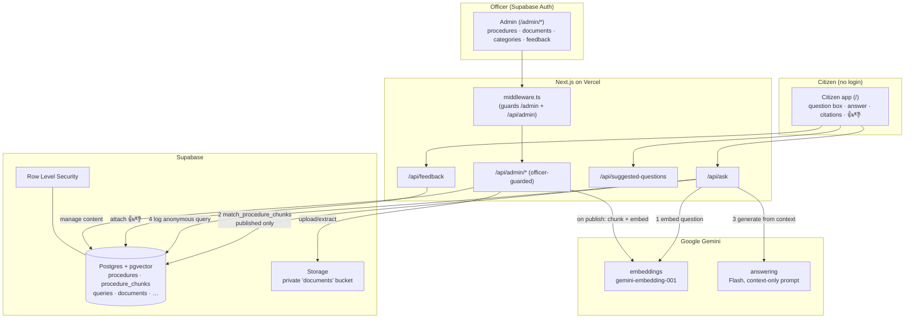
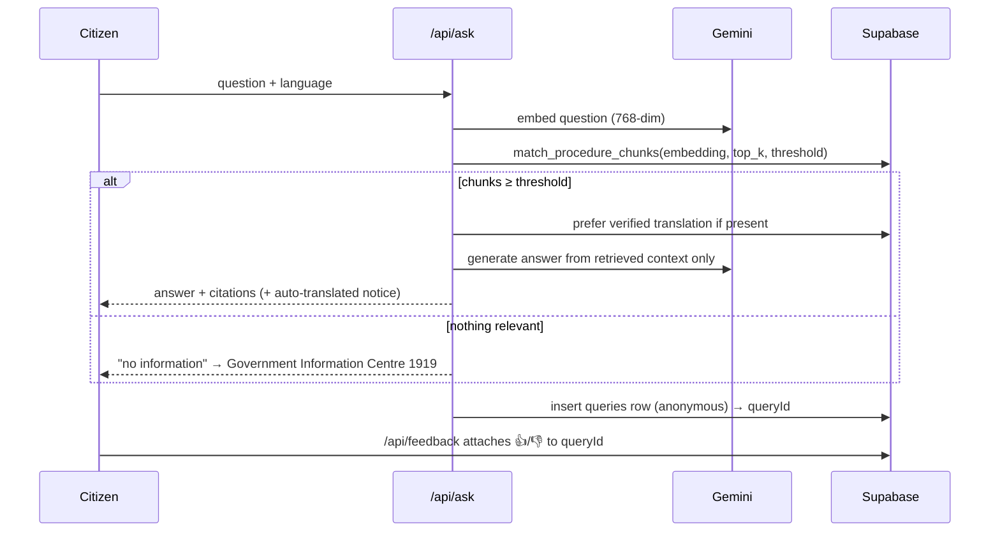
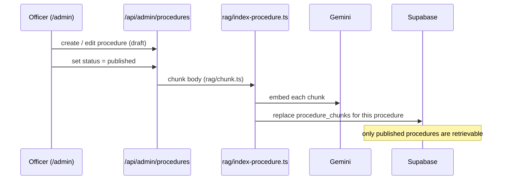

# InfoAI.LK — System Architecture

InfoAI.LK is a Smart Digital Guide that helps Sri Lankan citizens navigate
government and legal processes. Citizens ask a question in natural language
(English, සිංහල, or தமிழ்) and get an answer composed **only** from official
content entered by authorized officers, with source citations. If nothing
relevant is found, the system says so and points the citizen to the Government
Information Centre (**1919**) — it never answers from the model's own world
knowledge and never invents fees, timelines, or legal steps.

This document describes how the running system (see the repo root and
`src/`) fits together. For setup and environment variables, see the
[`README.md`](../README.md); for the database tables, see
[`data-model.md`](./data-model.md).

> **Scope note.** This is a complementary architecture reference for the Phase 1
> system that already ships on `main`. An earlier draft of this branch proposed a
> different schema (structured step/fee/document rows, `_en/_si/_ta` columns); it
> was dropped in favour of documenting what is actually built.

---

## 1. Two audiences, two trust levels

| Audience | Auth | What they do |
| --- | --- | --- |
| **Citizen** | none (anonymous) | Ask questions, read answers + citations, use suggested-question chips, leave 👍/👎 feedback. |
| **Officer / admin** | Supabase Auth | Manage procedures, documents, categories, suggested questions; review feedback and content gaps. Role is **flat** — every authenticated user is an officer. |

The trust split is enforced in the database with Row Level Security, not just in
the UI: citizens (the `anon` key) can read only **published** content and insert
a query row; officers (the `authenticated` key) manage content; the server uses
the **service role** (which bypasses RLS) for RAG retrieval and privileged writes.

---

## 2. Stack

| Layer | Choice |
| --- | --- |
| Frontend / hosting | Next.js (App Router, React) + Tailwind, on Vercel |
| Database & auth | Supabase (PostgreSQL + `pgvector`); Supabase Auth for officers |
| Answering LLM | Google Gemini, Flash tier (`GEMINI_ANSWER_MODEL`) |
| Embeddings | `gemini-embedding-001`, MRL-truncated + L2-normalized to **768** dims |
| File storage | Supabase Storage — private `documents` bucket for uploaded PDFs/DOCX |

---

## 3. High-level architecture

---

## 4. The RAG answer path (`/api/ask` → `src/lib/rag/answer.ts`)

1. **Embed** the citizen's question with Gemini (`src/lib/gemini/embeddings.ts`),
   L2-normalized to 768 dims.
2. **Retrieve** the top-`RAG_TOP_K` chunks via the `match_procedure_chunks` RPC —
   cosine similarity over `procedure_chunks` whose parent procedure is
   **published**, filtered by `RAG_MATCH_THRESHOLD`. Each hit carries its source
   procedure's title, department, fees, timeline and last-verified date for
   citations.
3. **Verified-translation override.** If the citizen's language has an
   officer-verified translation (`procedure_translations`) for a cited procedure,
   that text is preferred over machine translation.
4. **Generate** the answer with Gemini under a strict *context-only* prompt
   (`src/lib/gemini/generate.ts`). If retrieval returned nothing above threshold,
   the system returns the **"no information"** fallback pointing to **1919** —
   it does not call the model to improvise.
5. **Citations + notice.** The response (`AskResponse`) includes `citations`
   (department + last-verified date), an `autoTranslated` flag when the answer was
   machine-translated, and the resolved `language`.
6. **Log** the turn anonymously to `queries` (question, language,
   `retrieved_chunk_ids`, answer, `answered`) and return its `queryId` so the
   citizen can later attach 👍/👎 via `/api/feedback`.

---

## 5. Content lifecycle (officer → vector store)

Officers author a procedure as free-text `body` in its `authoring_language`, with
free-text `fees` and `timeline` and a `last_verified_date`. Publishing triggers
chunk + embed:

Seeded procedures (migration `0004_seed.sql`) are inserted directly and have **no
embeddings** until an officer runs `POST /api/admin/reindex` or re-saves them.

Uploaded official documents (PDF/DOCX) go through text extraction
(`src/lib/documents/extract.ts`) into the private `documents` Storage bucket
(`src/lib/documents/storage.ts`), versioned in `documents` / `document_versions`;
citizens never read the DMS directly.

---

## 6. Module map

| Path | Responsibility |
| --- | --- |
| `src/app/page.tsx`, `src/components/citizen/CitizenApp.tsx` | Citizen app (omnibox, answer panel, chips, feedback) |
| `src/app/admin/**` | Officer portal pages |
| `src/app/api/ask/route.ts` | Citizen Q&A endpoint |
| `src/app/api/feedback/route.ts` | Attach 👍/👎 to a logged query |
| `src/app/api/suggested-questions/route.ts` | Public chips |
| `src/app/api/admin/**` | Officer-guarded content/document/category/query APIs + `reindex` |
| `src/middleware.ts` | Guards `/admin` and `/api/admin` behind an officer session |
| `src/lib/rag/{answer,chunk,index-procedure}.ts` | RAG: answer, chunking, publish-time embedding |
| `src/lib/gemini/{client,embeddings,generate}.ts` | Gemini client, embeddings, strict answering prompt |
| `src/lib/supabase/{client,server,admin,auth}.ts` | Browser / server / service-role clients + auth helpers |
| `src/lib/documents/{extract,storage}.ts` | Document text extraction + Storage access |
| `src/i18n/dictionaries.ts` | UI strings for EN / සිංහල / தமிழ් |
| `supabase/migrations/*` | Schema, RLS, `match_procedure_chunks`, seed, Storage bucket |

---

## 7. Guardrails (non-negotiable)

- Citizen answers come from retrieved government content **only** — never the
  model's own knowledge; no invented fees, timelines, or legal steps.
- Every answer cites its source and last-verified date.
- Only **published** procedures are retrievable (enforced by RLS *and* the RAG SQL
  function).
- Auto-translated legal content carries the translated notice unless a verified
  translation exists.
- Secrets (Gemini key, Supabase service-role key) stay server-side; only
  `NEXT_PUBLIC_*` reaches the browser.

## 8. Phase 2 (deferred, designed for)

Interactive document checklist, "find nearest office" Maps links, printable
one-page summaries, and an analytics dashboard.
