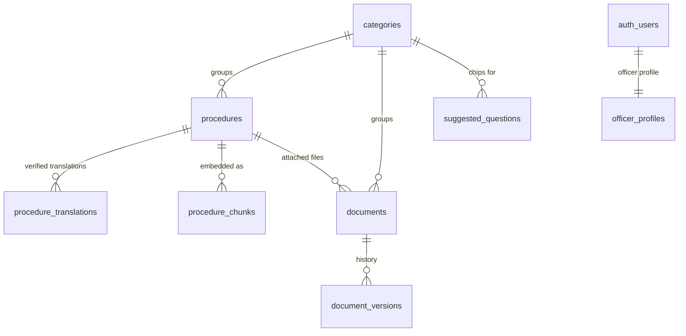

# InfoAI.LK — Data Model

The schema lives in `supabase/migrations/` and is applied in order:
`0001_init.sql` (tables + indexes), `0002_rls.sql` (Row Level Security),
`0003_functions.sql` (`match_procedure_chunks`), `0004_seed.sql` (categories +
flagship NIC content), `0005_storage.sql` (the `documents` Storage bucket). This
document is the table-by-table reference and ERD; the TypeScript row shapes are in
`src/lib/types.ts`.

## Entity-relationship diagram



`queries` has no foreign keys — it stores anonymous analytics and references
chunk ids only as a plain `uuid[]` (`retrieved_chunk_ids`).

## Conventions

- **UUID** primary keys via `gen_random_uuid()` (pgcrypto).
- **`updated_at`** maintained by the `set_updated_at()` trigger on mutable tables.
- **Enums:** `language_code` (`en`/`si`/`ta`), `procedure_status`
  (`draft`/`published`), `feedback_value` (`up`/`down`).
- **Trilingual by translation, not columns.** A procedure stores one `body` in its
  `authoring_language`; other languages are served by machine translation at answer
  time, overridden by an officer-verified row in `procedure_translations` when one
  exists.
- **Fees/timeline are free text** on `procedures` (e.g. `"Rs. 500. One Day
  Service: + Rs. 500"`, `"3–4 weeks"`), not structured money/step rows.

---

## Tables

### Catalog & content

| Table | Purpose |
| --- | --- |
| `categories` | Top-level groupings (name, `slug`, `display_order`, `is_archived`). |
| `procedures` | A government procedure: `title`, free-text `body`, `source_department`, free-text `fees` and `timeline`, `authoring_language`, `last_verified_date`, `status` (draft/published), `created_by`. Indexed on `category_id` and `status`. |
| `procedure_translations` | Officer-**verified** translations of a procedure's body, one per `(procedure_id, language)`. Preferred over machine translation. |
| `suggested_questions` | Curated citizen prompt chips per category (`question_text`, `display_order`, `is_active`). |

### RAG

| Object | Purpose |
| --- | --- |
| `procedure_chunks` | The vector store: `chunk_index`, `chunk_text`, `embedding vector(768)`, unique per `(procedure_id, chunk_index)`. `ivfflat` cosine index `idx_chunks_embedding`. Rebuilt on publish from the procedure body. |
| `match_procedure_chunks(query_embedding, match_count, match_threshold)` | `0003_functions.sql`. Cosine-similarity search joined to **published** procedures; returns `similarity = 1 - cosine_distance` plus each chunk's procedure title, department, fees, timeline, language, last-verified date and category for citations. |

> **Embedding dimension (768)** must match `GEMINI_EMBEDDING_DIM`. Changing it
> means editing `vector(768)` in `0001_init.sql`, the env var, and re-embedding all
> published procedures.

### Document management (officer-only DMS)

| Table | Purpose |
| --- | --- |
| `documents` | Uploaded official files: `title`, `file_path` (within the private Storage bucket), `file_type`, `version`, `is_archived`, optional `category_id`/`procedure_id`. |
| `document_versions` | Append-only version history per document (`document_id`, `version`, `file_path`). |

The private `documents` Storage bucket and its officer-only policies are created in
`0005_storage.sql`; downloads are served via short-lived signed URLs. Citizens never
read the DMS.

### Identity & analytics

| Table | Purpose |
| --- | --- |
| `officer_profiles` | Mirrors `auth.users` (`id`, `full_name`); an officer manages only their own row. All authenticated users are officers (flat role). |
| `queries` | Anonymous analytics + feedback: `question_text`, `language`, `retrieved_chunk_ids uuid[]`, `answer_text`, `answered` (false = "no info" fallback), `feedback` (`up`/`down`, null until voted). Indexed on `created_at` and `feedback`. Drives the admin feedback/content-gap view. |

---

## Row Level Security (`0002_rls.sql`)

| Table | `anon` (citizen) | `authenticated` (officer) |
| --- | --- | --- |
| `categories` | read where `is_archived = false` | full manage |
| `procedures` | read where `status = 'published'` | full manage |
| `procedure_translations` | read if parent procedure published | full manage |
| `procedure_chunks` | read if parent procedure published | full manage |
| `suggested_questions` | read where `is_active = true` | full manage |
| `documents`, `document_versions` | **no access** | full manage |
| `officer_profiles` | — | own row only |
| `queries` | insert; update (to attach feedback) | read all |

The **service role** bypasses RLS and is used server-side for RAG retrieval and
privileged admin writes; these policies are the safety net for anything that runs
under the `anon`/`authenticated` keys (e.g. the browser).

---

## Applying the schema

```bash
# Supabase SQL Editor, or:
supabase db push
```

Run `0001`→`0005` in order. Seeded procedures have no embeddings until an officer
calls `POST /api/admin/reindex` or re-saves each procedure. See the
[`README.md`](../README.md) for full setup.
