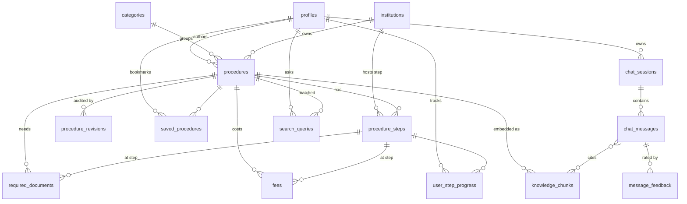

# Info-AI.LK — Data Model

The schema lives in `supabase/migrations/0001_init.sql`. This document explains
each table and the decisions behind it. Four groups:

1. **Catalog** — the authored, trilingual civic content (procedures, steps, docs, fees)
2. **Knowledge** — the `pgvector` RAG store derived from published catalog content
3. **Engagement** — citizen accounts, bookmarks, step progress, chat
4. **Analytics / audit** — query logs and an append-only edit history

## Entity-relationship diagram



## Cross-cutting conventions

- **UUID keys** via `gen_random_uuid()` (pgcrypto).
- **Trilingual columns** `_en` / `_si` / `_ta`. English is `not null`; Sinhala and
  Tamil are nullable and the app falls back to English when a translation is missing.
  Explicit columns (over a JSONB blob) keep the CMS forms and queries simple and let
  us index/validate each language independently. Languages are fixed at three.
- **Money** is integer `amount_cents` in LKR — never floats.
- **`updated_at`** is maintained by the `set_updated_at()` trigger on every mutable table.

---

## 1. Catalog

| Table | Purpose |
| --- | --- |
| `categories` | Homepage groupings and quick links (National ID, Vehicles, Utilities…). |
| `institutions` | Government offices (Police, Grama Niladhari, Divisional Secretariat, DRP, DMT…) referenced by procedures and steps. `contact` JSONB holds hotline/address. |
| `procedures` | One civic procedure (e.g. *Replace lost NIC*). Slug, category, owning institution, `status`, trilingual title/summary/overview/duration, `keywords[]` for Singlish & synonyms, version + publish timestamp, author/editor. |
| `procedure_steps` | Ordered steps rendered as the **interactive timeline**. `step_number` is unique per procedure; `institution_id` is where the step happens; `online_url` set when a step can be done online. |
| `required_documents` | The **document checklist**. Linked to a procedure and optionally to the step where the document is needed. Tracks original-vs-copy and `copies_required`. |
| `fees` | Fee **line items** (standard / penalty / express / optional) with `effective_from` dates, so a fee change is an update with history, not an overwrite. |
| `procedure_revisions` | Append-only JSON snapshots of each published version for audit ("who changed the fee, when"). |

**Why steps, documents and fees are relational (not LLM text):** the UI renders the
timeline and checklist directly from these rows, and the figures are authoritative.
The LLM only *presents* them — it never originates a fee or a step.

---

## 2. Knowledge (RAG / pgvector)

| Table / function | Purpose |
| --- | --- |
| `knowledge_chunks` | Published content chunked per `locale`, with `embedding vector(768)` and a `content_hash` so the embed job re-embeds only what changed. An `ivfflat` cosine index serves similarity search. |
| `match_knowledge(query_embedding, match_count, filter_locale, min_similarity)` | SQL RPC called by `/api/ask`. Returns the closest chunks (optionally per-locale) with a `similarity` score and the source `procedure_id` for citations. |

Dimension `768` is pinned to Gemini `text-embedding-004`. Switching embedding models
means a re-embed migration (drop/rebuild the vectors + index). Only **published**
content is embedded, so drafts never surface in citizen answers. The embed job runs
with the Supabase **service role** (bypasses RLS); the anon/auth API cannot write chunks.

---

## 3. Engagement

| Table | Purpose |
| --- | --- |
| `saved_procedures` | Bookmarks; composite PK `(user_id, procedure_id)`. |
| `user_step_progress` | Per-step checklist state synced across devices; unique per `(user_id, step_id)`. |
| `chat_sessions` | Conversations. `user_id` is **nullable** so anonymous use is first-class; anonymous rows are reached only via the server (service role). |
| `chat_messages` | Turns, with `retrieved_chunk_ids[]` (citations/audit), resolved `procedure_id`, and model/token/latency telemetry. |
| `message_feedback` | Thumbs up/down (`rating` −1/+1) + optional comment; one per user per message. |

---

## 4. Analytics

| Table | Purpose |
| --- | --- |
| `search_queries` | Every query logged with `had_answer`. The partial index on `had_answer = false` makes **content-gap analysis** cheap — what citizens ask that the catalog doesn't yet cover drives the content roadmap. |

---

## Row Level Security summary

| Who | Can read | Can write |
| --- | --- | --- |
| **Anonymous / citizen** | `published` procedures (+ their steps/docs/fees), all categories & institutions | own profile, bookmarks, step progress, own chat & feedback |
| **Editor / admin (`is_staff()`)** | everything, including drafts | all catalog content, revisions, chunks |
| **Admin (`is_admin()`)** | everything | everything, plus users' roles in `profiles` |
| **Service role** (embed job, server `/api/ask`) | bypasses RLS | writes chunks, logs queries, manages anonymous chat rows |

`is_staff()` / `is_admin()` are `security definer` helpers so policies don't recurse
through `profiles`. The admin/editor split is enforced in the database, not just the UI.

---

## Running the migration

```bash
# with the Supabase CLI against a linked project
supabase db push

# or apply the file directly
psql "$SUPABASE_DB_URL" -f supabase/migrations/0001_init.sql
```

After the first bulk embed, rebuild the ANN index for a good list count:

```sql
reindex index idx_chunks_embedding;  -- or recreate with lists ≈ sqrt(rows)
```
